<div align="center">

# ◇ SENTRA

### Stop what went wrong. Keep everything else.

**Voice-guided containment and recovery for teams of AI agents.**<br>
SENTRA notices when allowed steps add up to something unsafe, pauses only the work that is affected,<br>
and repairs it from instructions you say out loud with Wispr Flow.

[](https://ishaans04.github.io/SENTRA/)
[](https://www.wemakedevs.org/wispr#about)
[](https://www.wemakedevs.org/wispr#about)

[](https://github.com/ishaans04/SENTRA/actions/workflows/ci.yml)
[](https://github.com/ishaans04/SENTRA/actions/workflows/pages.yml)
[](#tests-and-quality)
[](https://wisprflow.ai)
[](#limits-stated-up-front)
[](LICENSE)

[](https://www.python.org/)
[](https://fastapi.tiangolo.com/)
[](https://gofastmcp.com/)
[](https://react.dev/)
[](https://www.typescriptlang.org/)
[](https://vite.dev/)
[](https://ai.google.dev/)
[](Dockerfile)

**[Live site](https://ishaans04.github.io/SENTRA/)** &nbsp;·&nbsp;
**[Guided walkthrough](https://ishaans04.github.io/SENTRA/#/demo)** &nbsp;·&nbsp;
**[Replay console](https://ishaans04.github.io/SENTRA/#/console)** &nbsp;·&nbsp;
**[Demo guide](demo.md)** &nbsp;·&nbsp;
**[Run it locally](#run-it-locally)**

<br>

<a href="https://ishaans04.github.io/SENTRA/">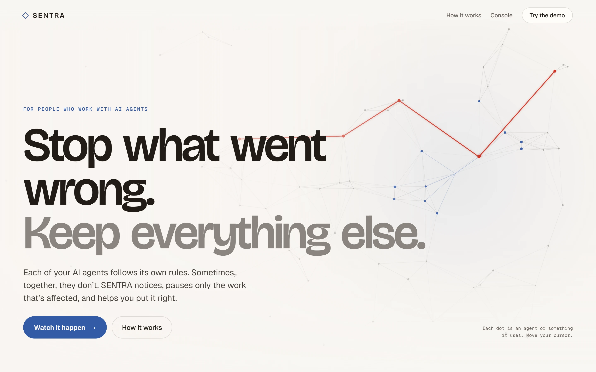</a>

</div>

> [!NOTE]
> **Built for *No Hands: The Wispr Challenge*** by WeMakeDevs × Wispr Flow (16 to 31 October 2026), **Track 1: Builders**. A solo entry by **Ishaan Sharma**, built by voice. Everything in the demo runs on fictional data. The tool servers are fictional, the webhook only counts deliveries, and nothing outside the sandbox is contacted.

## At a glance

AI agents now do real work side by side: one answers support tickets, another writes the weekly partner report. Each step they take can be allowed on its own and still add up to something nobody approved, such as private customer details finding a way out of the company. The usual answer is to shut everything down. **SENTRA stops only the work that became unsafe, repairs it, leaves the rest running, and remembers the fix so the same thing is refused next time.**

| **01 · Notice** | **02 · Pause** | **03 · Repair** | **04 · Remember** |
| :-- | :-- | :-- | :-- |
| Sees when safe steps add up to an unsafe route, and shows exactly which calls did it. | Remembers *why* each job was approved. When that reason stops being true, it pauses that job alone and holds anything it was about to send. | You say how to recover, in your own words. SENTRA reads them back as exact steps, runs nothing until you confirm, rebuilds the work the right way and never overwrites a person's edit. | You say what should always hold. SENTRA reads it back with the incident behind it, keeps it once you confirm, and refuses the same risky step in every later session. |

## See it work

<div align="center">

<a href="https://ishaans04.github.io/SENTRA/#/demo">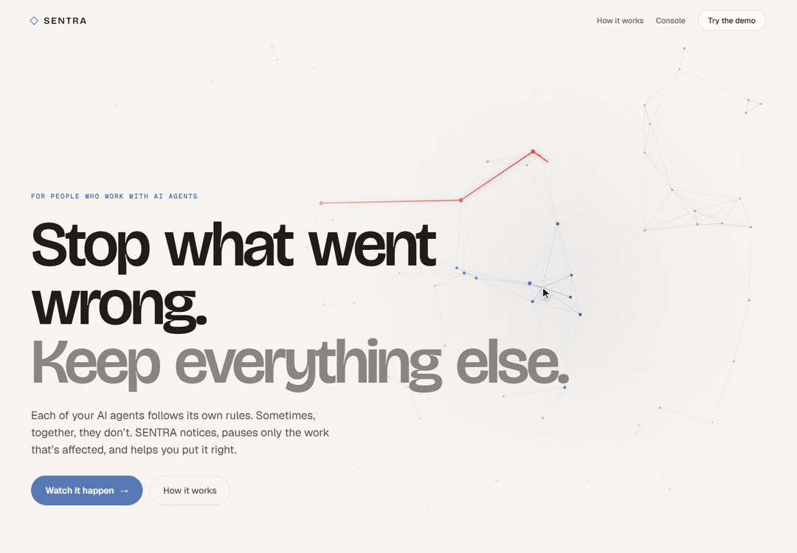</a>

<sub>The guided walkthrough, recorded from the live site. Made-up data, about a minute. <a href="https://ishaans04.github.io/SENTRA/#/demo"><b>Try it yourself →</b></a></sub>

</div>

This is how SENTRA is meant to be used: you watch the agents work, SENTRA flags the moment their allowed steps line up into a leak, you fix it by saying one sentence, and one more sentence makes sure it can't happen the same way again.

| Step | What happens | What SENTRA does |
| :-- | :-- | :-- |
| **01)  Meet the team** | Support helps customers. Reporting sends a weekly report to partners. You approved Reporting on one condition: it only reads approved summaries. | Records the approval *and its reason* as a typed condition it can re-check. |
| **02)  Something new shows up** | Support starts saving notes to a shared notepad. That's allowed, but nobody planned for it. | Marks the notepad as observed but not in the manifest. |
| **03)  The pieces line up** | Reporting reads the notepad too. | Finds a possible route from private customer data to the outside, through four steps that were each allowed. |
| **04)  The reason is gone** | Reporting no longer reads only approved summaries, and a report is about to go out. | Pauses that one approval and holds the report at the gateway. |
| **05)  Tell SENTRA what to do** | You speak normally with Wispr Flow: *"Stop this report, cut its access to the notepad, and rebuild it from approved summaries. Keep the support work."* | Reads it back as four clear steps. Nothing happens until you say yes. |
| **06)  Fixing only what's broken** | One small change at a time. | Stops the old report, cuts one link, turns away a late send, rebuilds the report and keeps Priya's edit. |
| **07)  All clear** | Support never stopped working. | Measures the result: route closed, old report never sent, new report sent safely, Support's and Priya's work untouched. |
| **08)  Remember it** | You say: *"From now on, an agent that can send outside never reads from a store nobody declared."* | Reads it back with the incident behind it (PS-001, run r-0412, four calls cited) and keeps it as standing order SO-1 once you confirm. |
| **09)  A week later** | Support saves notes to the notepad again, and Reporting tries to read it. | Refuses that one read at the gateway under SO-1, quoting your words. No route forms, nothing pauses, the report goes out on time. |

## The problem

**Every step was allowed. That's the problem.**

```mermaid
flowchart LR
    CRM[("Customer records<br/>private")]
    SUP(["Support agent"])
    PAD[["Shared notepad<br/>not in the plan"]]
    REP(["Reporting agent"])
    OUT{{"Outside world<br/>partner webhook"}}

    CRM -- "1 · Support reads · allowed" --> SUP
    SUP -- "2 · saves notes · allowed" --> PAD
    PAD -- "3 · Reporting reads · allowed" --> REP
    REP -- "4 · sends the report · allowed" --> OUT

    classDef data fill:#FBEAE7,stroke:#CC3526,color:#5A160F
    classDef agent fill:#EAF0FA,stroke:#335AA6,color:#1B2F57
    classDef odd fill:#FBF3DF,stroke:#B07A12,color:#4A3306,stroke-dasharray:4 3
    class CRM,OUT data
    class SUP,REP agent
    class PAD odd
    linkStyle default stroke:#CC3526,stroke-width:2px
```

Nobody broke a rule and no one meant harm. Checking each agent on its own would never catch it, because the risk only exists in the **combination**. Put together, private customer details now have a way out.

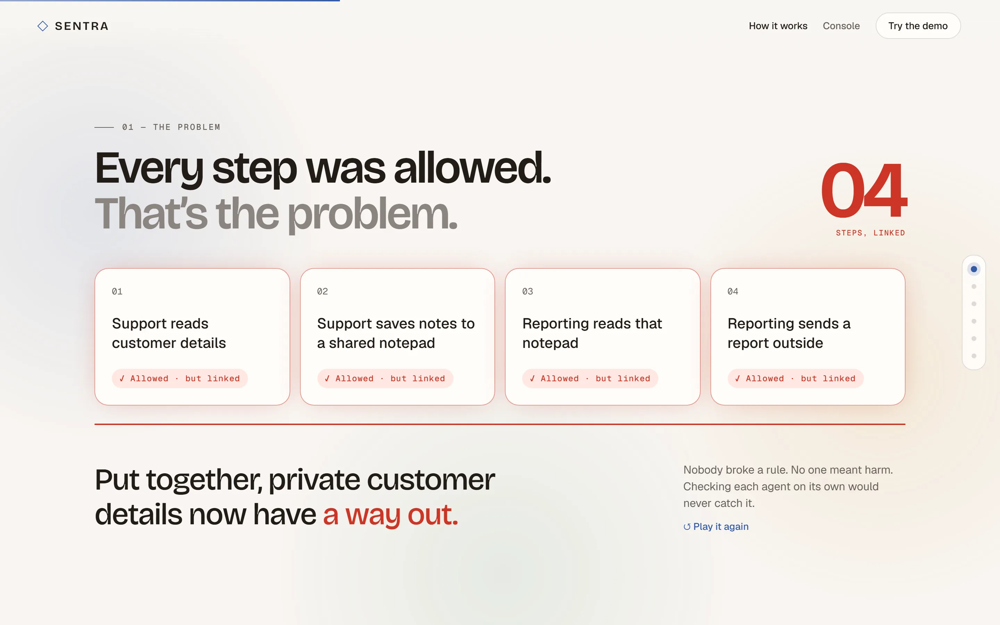

The tools teams have today all fail in the same place:

| | Shut everything down | Ask a chatbot | **SENTRA** |
| :-- | :-: | :-: | :-: |
| Sees the route **across** agents | ✕ | ✕ only what you paste | ✓ a graph of every call |
| Stops the risky send in time | ✓ along with everything else | ✕ it gives advice | ✓ holds only that send |
| Keeps unrelated work running | ✕ | ✓ nothing stops | ✓ |
| Remembers *why* you approved the job | ✕ | ✕ | ✓ typed conditions, re-checked on every finding |
| Repairs, not just stops | ✕ by hand, later | ✕ | ✓ confirmed and then verified |
| Protects a person's edits | ✕ | ✕ | ✓ never overwritten |
| Remembers the fix next time | ✕ | ✕ forgets between chats | ✓ standing orders, enforced in every later session |

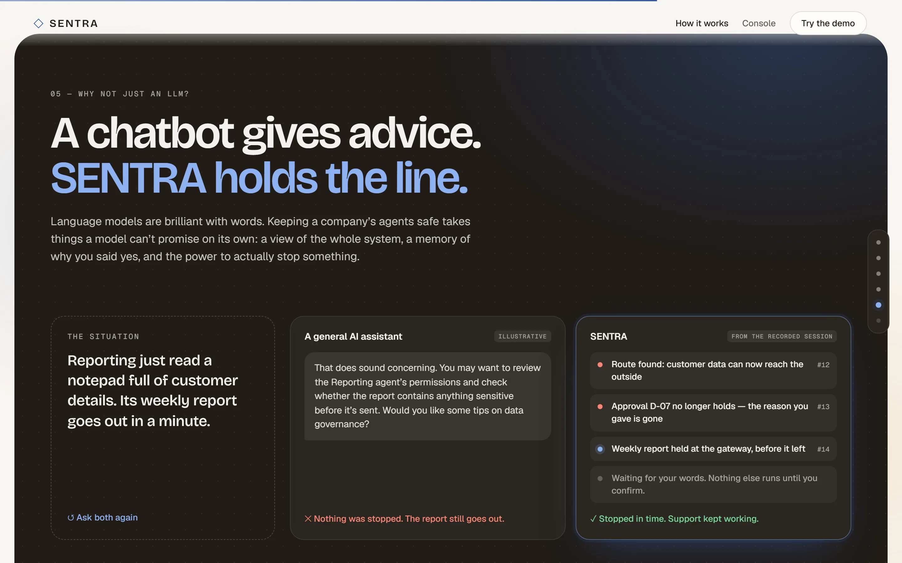

## The challenge, and why SENTRA

> **No Hands: The Wispr Challenge** · WeMakeDevs × Wispr Flow · 16 to 31 October 2026<br>
> *"If you can speak it, you can build it."* · [Challenge details](https://www.wemakedevs.org/wispr#about) · `#NoHandsChallenge`

The challenge asks people to fix a real problem in their own work by building a tool for it, and to do the building with their voice. Every entry starts from *whatever slows you down*.

SENTRA is entered in **Track 1: Builders**, the track for developers:

> *"A working software product that solves a problem in your own work. Dictate requirements and follow-ups into your coding tools, and let them do the coding."*

**The problem, from a developer's chair.** If you work with AI agents, you know the moment. Something looks wrong: a report about to go out, an agent that read something it shouldn't have. The only button you have is *stop everything*. Hours of good work go down with the bad, and then you're the one digging through logs to work out what happened and redoing it by hand. That stop-everything-then-clean-up loop is what slows a developer down once agents do real work. SENTRA removes it: it finds the cause, stops only that, and fixes it from one spoken sentence.

| Track 1 asks for | How SENTRA answers |
| :-- | :-- |
| **A working software product** | A live site (landing page, guided walkthrough, replay console), a FastAPI service with an MCP gateway, a Docker image, and 395 automated tests run in CI on every push. |
| **That solves a problem in your own work** | The stop-everything problem above: when agents' allowed steps add up to something unsafe, stop and repair only that, and keep everything else running. |
| **Dictate requirements and follow-ups into your coding tools** | SENTRA was specified and steered by voice. Requirements, design decisions, reviews and follow-ups were dictated with Wispr Flow into AI coding tools, which wrote the code. |
| **Voice at the centre** | The product runs on voice too. Approvals, recovery instructions, standing orders, corrections and the final "Confirm" are all spoken with Wispr Flow, and SENTRA reads every instruction back before anything runs. |

**Why voice fits this problem.** In an incident, the person in charge knows what they want ("stop the report, keep support running") long before they could write it as a policy or click through five consoles. Speaking is the fastest way to say it. The read-back is what makes it safe: your words become exact, checkable steps, and nothing runs until you confirm them.

## How SENTRA works

SENTRA has two parts that work together.

- **The control engine** (`services/core`) keeps a picture of what each agent is allowed to reach and what it actually touched. It turns every observed call into a graph, runs the route rules over it (**PS-001**: restricted data can reach the outside through a path nobody declared; **PS-002**: one agent runs content another agent wrote) and plans containment. It tests each candidate control first and recommends the cheapest one that does not break agreed work.
- **The gateway and decision layer** (`services/sentra`) sits between the agents and their tools. It records every approval with its condition, re-checks conditions as the engine reports findings, holds and rejects calls from runs whose approval has fallen, carries out dictated recovery once you confirm the read-back, and keeps your standing orders from one session to the next.

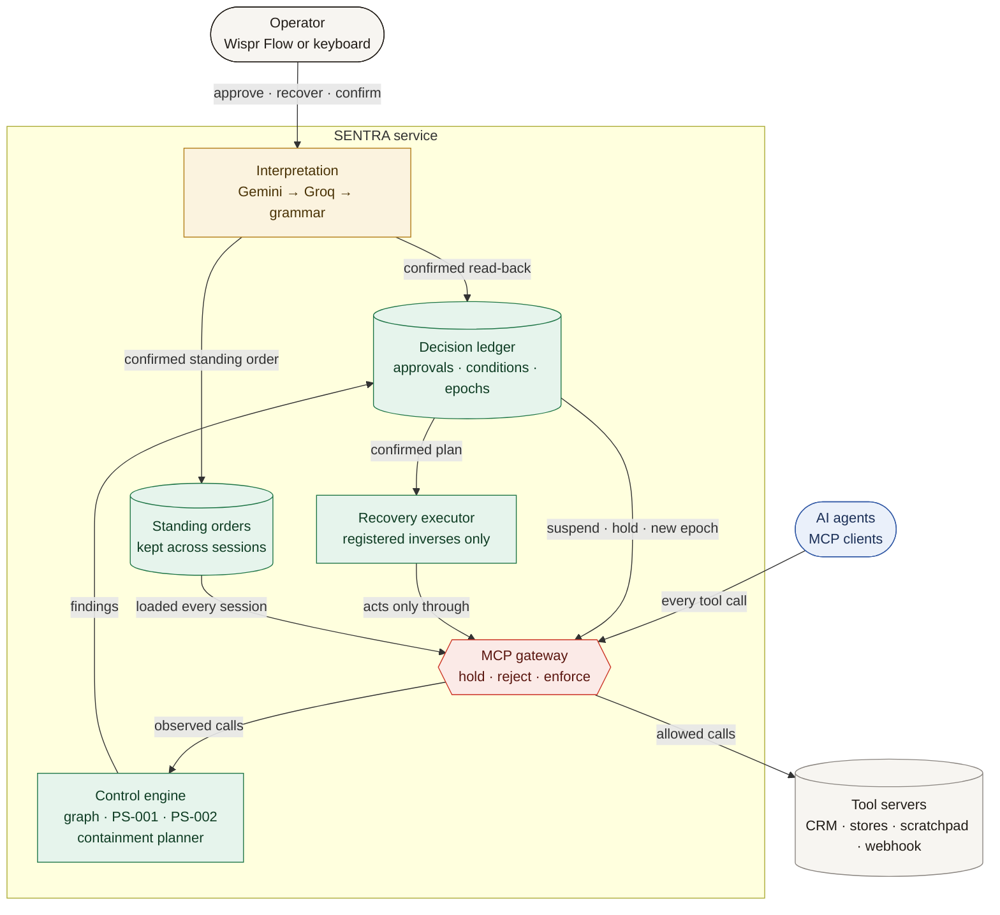

Interpretation (amber) only ever proposes a typed plan. Everything that enforces (green and red) is deterministic code.

| Design rule | What it means in practice |
| :-- | :-- |
| **One route to the tools** | Agents are MCP clients. Each connection is bound to one run, so identity comes from the connection, never from tool arguments. |
| **Approval epochs are fencing tokens** | Suspending an approval moves its epoch forward, and the gateway rejects every call from a run that started under the old one. |
| **Sends wait in an outbox** | Sends are re-checked at release, so a withdrawn approval can stop a report that is already on its way. |
| **Recovery is operation-specific** | Only registered inverses run, after a version check, under the recovery executor's own identity. Sends are irreversible and escalate. |
| **No model on the enforcement path** | With interpretation off (`SENTRA_INTERPRETER=off`) the whole storyline runs on the deterministic grammar and gives the same holds, rejections and recovery. |
| **One ledger** | Every call, rejected ones included, is a ledger event, and replaying an exported ledger rebuilds identical state. |
| **Memory is earned** | Only a confirmed read-back writes a standing order. Agents have no tool that reaches the book, and every order keeps the incident it came from. |

## Inside the gateway

Every tool call goes through one pure function, `enforce`, with no model and no network. The middleware calls it on the way in, and the outbox calls it again at release.

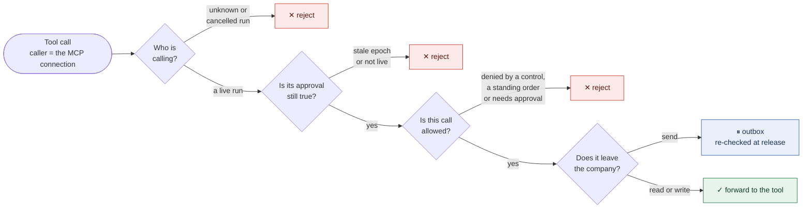

<details>
<summary><b>The exact order of checks</b></summary>

| # | Check | Verdict if it fails |
| :-: | :-- | :-- |
| 1 | The connection belongs to a registered run | `unknown_connection` |
| 2 | The run has not been cancelled | `run_cancelled` |
| 3 | The recovery executor never sends or destroys (its other calls go straight through) | `recovery_cannot_send` |
| 4 | The run started under its approval's current epoch | `stale_epoch` |
| 5 | The approval is live: not proposed, suspended, withdrawn or discarded | `decision_not_live` |
| 6 | The tool is not reserved for recovery | `recovery_only` |
| 7 | No containment control denies this actor and tool | `control_deny` |
| 8 | No standing order forbids this read | `standing_order` |
| 9 | A destructive call has a live approval for that exact target | `no_live_approval` |
| 10 | Sends are queued in the outbox; everything else is forwarded | *queue* or *forward* |

</details>

## Approvals that remember why

An approval in SENTRA is not a checkbox. It keeps the reason you gave. Say:

> *"Approve reporting, on the condition that the Reporting Agent only reads from the approved, sanitized report store."*

SENTRA reads it back as a typed, checkable condition, `ReadsOnlyFrom(reporting-agent, [report_store/approved_summaries])`, and records the approval with an **epoch**. From then on, every finding from the engine re-checks that condition against what the agents actually did.

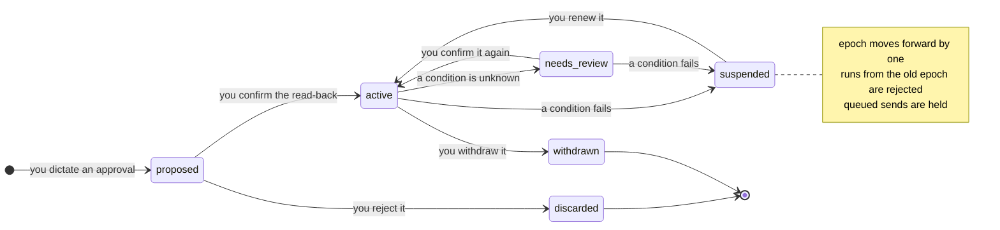

| When a condition is… | SENTRA… |
| :-- | :-- |
| **True** | Lets the work continue. |
| **Unknown** | Puts the approval in *needs review* and holds its queued sends. Other calls carry on. |
| **False** | Suspends the approval, moves its epoch forward (every run from the old epoch is now stale and rejected at the gateway), holds its queued sends under the pre-authorised hold rule, and raises one alert per finding. |

Renewal does not move the epoch. The suspension already fenced the old runs off; renewal only lets new runs start at the current epoch.

## Recovery, in your own words

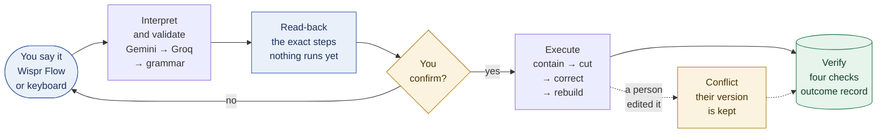

A model only ever fills in a typed proposal, using names taken from the session. Its output is validated exactly like the grammar's, and anything that fails validation counts as a provider failure, so the chain moves on. **The deterministic grammar is always the floor**, which is why the whole product works with no API keys at all.

Before anything is read back, the engine simulates every candidate control on a copy of the live graph. In the demo, blocking Support's read of the CRM would close the route, but it would also sever declared support work, so it is rejected. The cheapest control that keeps agreed work intact wins.

<details>
<summary><b>The recovery vocabulary</b>: the only steps a plan can contain</summary>

| Step | Phase | What it does |
| :-- | :-- | :-- |
| `CANCEL_RUN` | contain | Stops an affected run and cancels its queued or held sends |
| `HOLD_ACTION` | contain | Keeps a queued action in the outbox |
| `APPLY_CONTROL` | cut | Enforces a containment control the planner has already tested |
| `REVOKE_ACCESS` | cut | Removes one actor's access to one resource, and nothing else |
| `COMPENSATE` | correct | Undoes one executed call through its registered inverse, after a version check |
| `REBUILD` | rebuild | Renews the approval and starts a fresh run with a clean context, to rebuild from the named sources |
| `PRESERVE` | constraint | Protects a scope's declared work; no step in the plan may touch it |
| `ESCALATE` | escalate | Hands a person what cannot be undone, such as a send that already went out |

</details>

Recovery is **measured, not assumed**. Nothing in verification trusts the plan; each check measures the session as it is now:

| Check | What it measures | In the demo |
| :-- | :-- | :-- |
| `route_closed` | The engine's rules, re-run on the contained graph, find no route | PS-001 re-run · 0 findings |
| `stale_run_rejected` | A probe call from each cancelled run is refused by the gateway | r-0412's send rejected |
| `replacement_completed` | Each rebuilt run finished, read only its approved sources, and its send went out | r-0413 delivered under epoch 4 |
| `preserved_work_unchanged` | Work you asked to keep, and every human edit, is exactly as it was when you confirmed | Support untouched · Priya's edit preserved |

## Standing orders that remember why

Fixing an incident once is not the end of it. The same agents run again next week, and the same allowed steps can line up the same way. So after the outcome record, you say what should always hold:

> *"From now on, an agent that can send outside never reads from a store nobody declared."*

SENTRA reads it back before keeping anything:

```text
I will keep this standing order: an agent that can send outside never reads from storage nobody declared.
Checked as: NoUndeclaredReads(senders).
Today it covers: Reporting Agent reading Shared scratchpad.
Why: PS-001 in session s-recorded, citing 4 calls.
It holds in every later session until you revoke it.
```

Once you confirm, it is standing order **SO-1**. Every later session loads it before anything else happens and checks it at the gateway, right after the containment controls. A week later Support saves notes to the scratchpad again, which is still allowed because Support cannot send anything out. Reporting tries to read them and is refused under SO-1, with one alert that quotes your words. No route forms, no approval falls, and the report goes out on time.

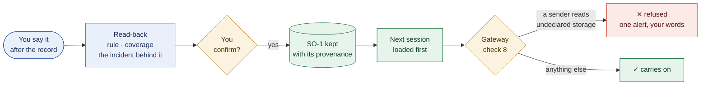

| Property | What it means |
| :-- | :-- |
| **Only your words write it** | Persistent memory is how agents get poisoned: a stray page or note becomes a "fact" they act on later. SENTRA's memory has no such door. Only a confirmed read-back writes a standing order, and no agent tool reaches the book. |
| **It knows where it came from** | Each order keeps the session, the finding, the recovery plan, the calls the finding cited and the runs that were cancelled. |
| **It is typed, not remembered prose** | `NoUndeclaredReads(senders)` is recompiled against each session's manifest, so an agent added later that can send outside is covered without editing the order. |
| **It is narrow** | It refuses one kind of read. Support's notes, approved reads and every other call carry on. |
| **You can take it back** | Revoking an order lifts it at once and in every later session. Over the API: `POST /api/standing-orders/{id}/revoke`. |

## The story the demo tells

The console replays one recorded session of 28 events in nine chapters. Here is the whole of it:

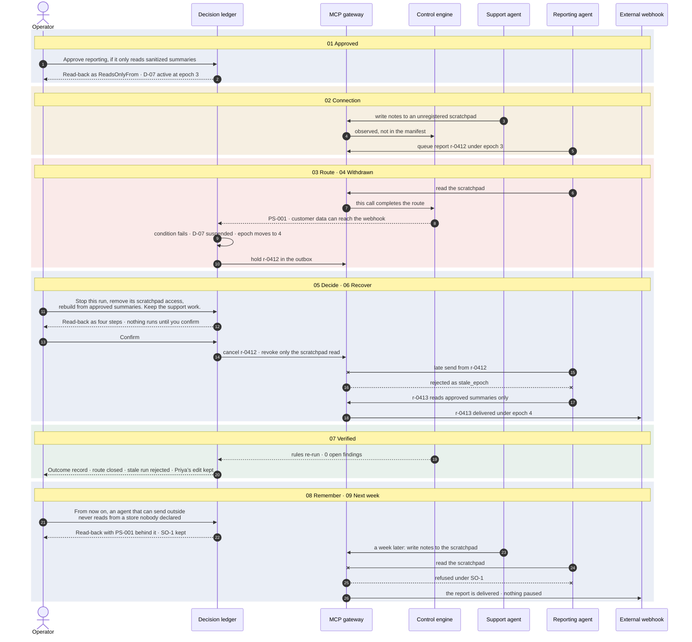

| Chapter | What you see |
| :-- | :-- |
| **01 Approved** | The operator approves reporting on one condition, recorded as decision D-07. |
| **02 Connection** | Support finds and writes to a scratchpad nobody declared. Reporting queues its next report. |
| **03 Route** | Reporting reads the scratchpad. The red route lights up from the customer records to the webhook, and finding PS-001 cites the four calls behind it. |
| **04 Withdrawn** | The condition fails, the approval falls, and the queued report is held at the gateway. |
| **05 Decide** | The operator dictates the recovery in plain words. SENTRA reads it back as gateway steps, with the controls it rejected and why. |
| **06 Recover** | The narrow recovery runs. A late send from the old run is rejected, and Priya's later edit to the draft survives as a conflict. |
| **07 Verified** | The rules re-run over the contained graph. The outcome record reports every check, the conflict included. |
| **08 Remember** | The operator dictates a standing order. It is read back with the incident behind it and kept as SO-1 on confirmation. |
| **09 Next week** | The same work a week later. Reporting's scratchpad read is refused under SO-1, no route opens, and the report goes out. |

## Screenshots

<table>
  <tr>
    <td width="50%">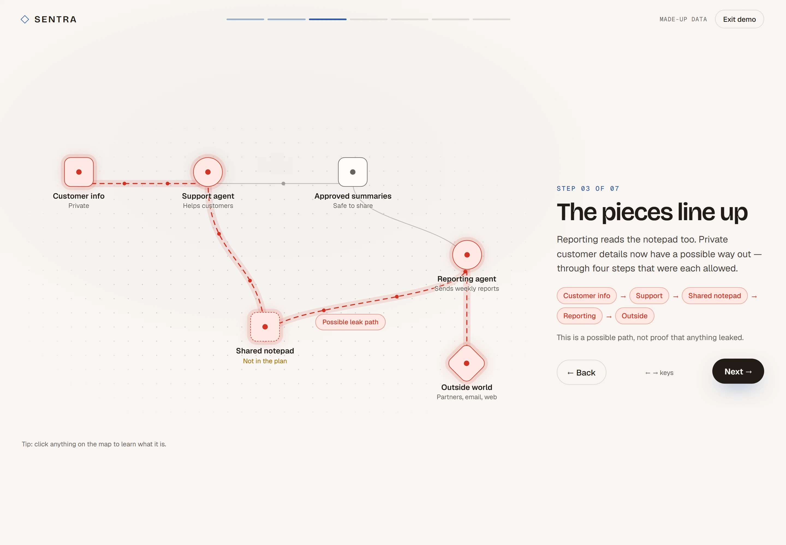</td>
    <td width="50%">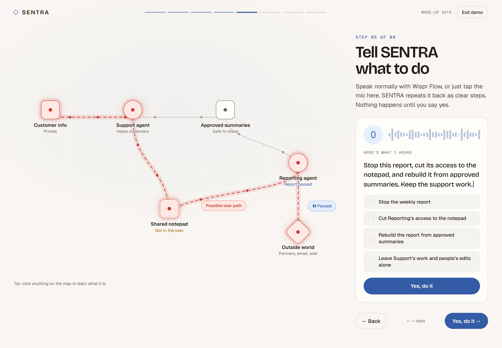</td>
  </tr>
  <tr>
    <td><sub><b>The pieces line up.</b> Four allowed steps form a possible leak path, and SENTRA says plainly that a path is not proof of a leak.</sub></td>
    <td><sub><b>Tell SENTRA what to do.</b> Your words, read back as four exact steps. Nothing happens until you say yes.</sub></td>
  </tr>
  <tr>
    <td>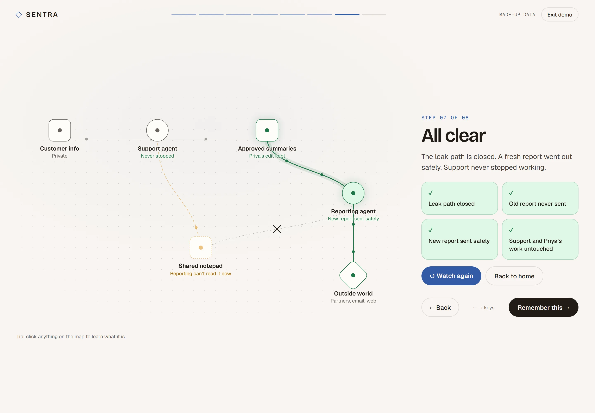</td>
    <td>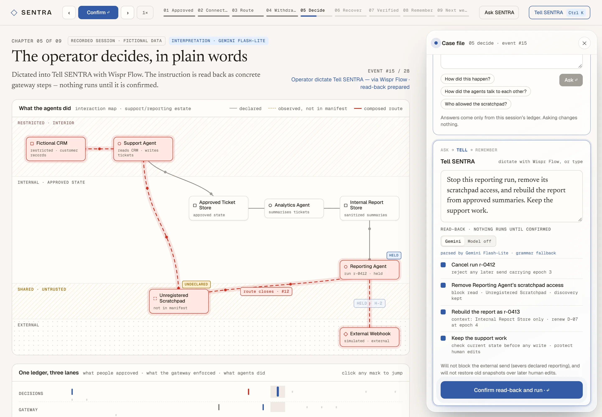</td>
  </tr>
  <tr>
    <td><sub><b>All clear.</b> The leak path is closed, a fresh report went out safely, and Support never stopped.</sub></td>
    <td><sub><b>Console · Decide.</b> The dictated instruction and its read-back. Controls that would sever declared work are shown as rejected.</sub></td>
  </tr>
  <tr>
    <td>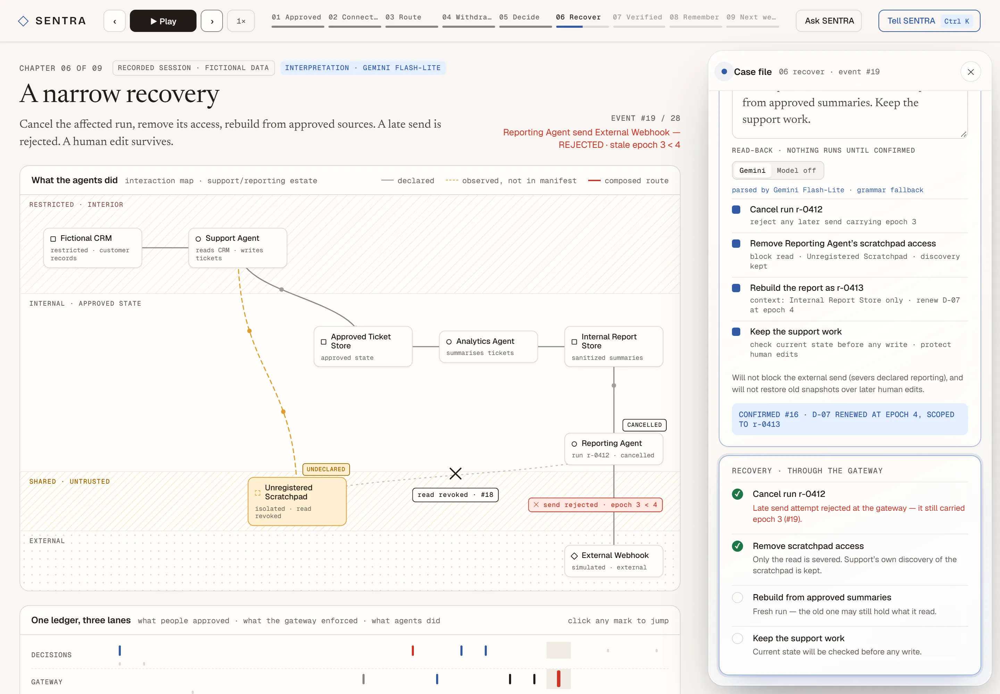</td>
    <td>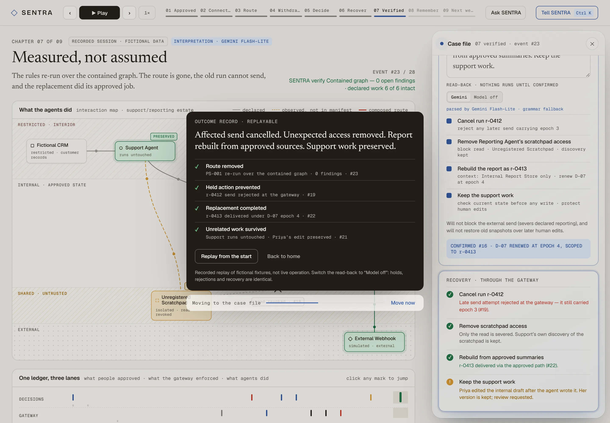</td>
  </tr>
  <tr>
    <td><sub><b>Console · Recover.</b> The old run is cancelled and its late send is rejected at the gateway: stale epoch, 3 against 4.</sub></td>
    <td><sub><b>Console · Verified.</b> The outcome record: route removed, held action prevented, replacement completed, unrelated work survived.</sub></td>
  </tr>
  <tr>
    <td>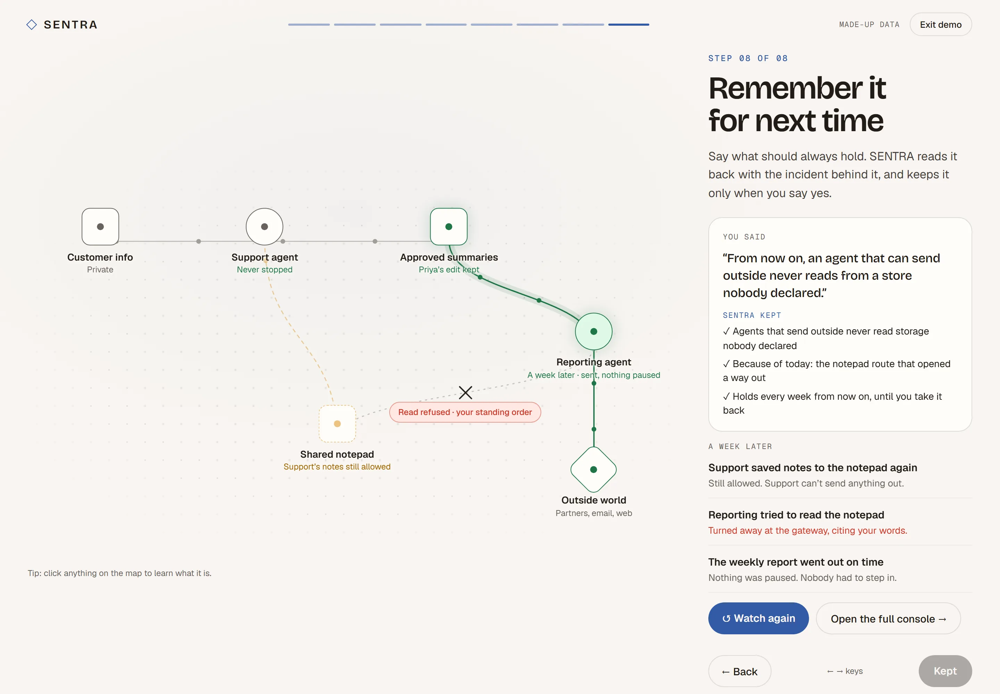</td>
    <td>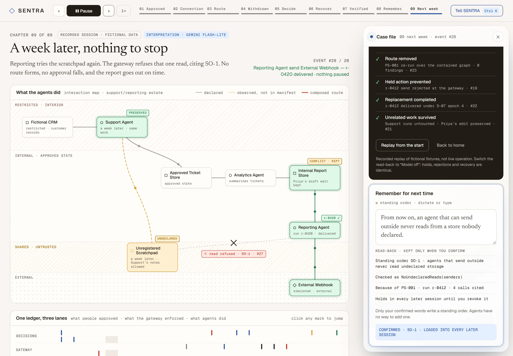</td>
  </tr>
  <tr>
    <td><sub><b>Remember it for next time.</b> Your standing order, read back and kept. A week later Reporting is turned away from the notepad and the report still goes out.</sub></td>
    <td><sub><b>Console · Next week.</b> The read is refused under SO-1, citing the incident it came from. No route forms and nothing pauses.</sub></td>
  </tr>
</table>

The site has three screens, all served from one static build:

| Address | Screen |
| :-- | :-- |
| [`/`](https://ishaans04.github.io/SENTRA/) | **Landing page.** The idea in a few short sections, each with something to try. |
| [`/#/demo`](https://ishaans04.github.io/SENTRA/#/demo) | **Guided walkthrough.** The whole story in eight steps on one map. |
| [`/#/console`](https://ishaans04.github.io/SENTRA/#/console) | **Console.** The recorded session as an operator sees it, with every event, approval and check. |

The console plays a session recorded from the service, so the site works from any static host. **[demo.md](demo.md)** walks through every screen.

## Voice first, with Wispr Flow

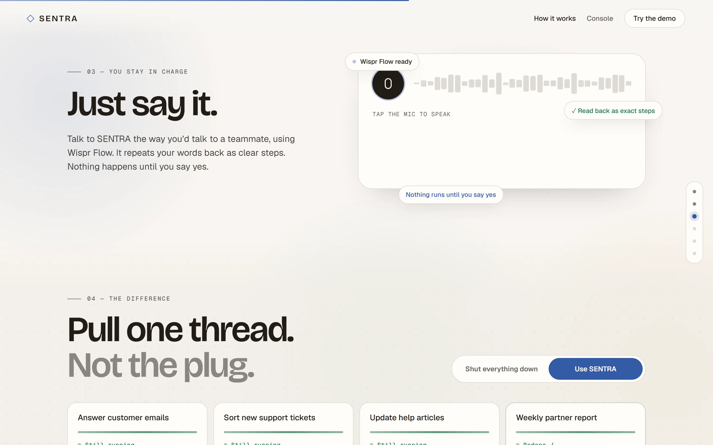

Every text box is a plain field, so Wispr Flow types straight into it: the approval, the recovery instruction, corrections and the spoken "Confirm". SENTRA never talks to Wispr and cannot tell dictated text from typed text, which is why every step also works by typing.

| You say | SENTRA reads it back as |
| :-- | :-- |
| *"Approve reporting, on the condition that the Reporting Agent only reads from the approved, sanitized report store."* | An approval with the typed condition `ReadsOnlyFrom(reporting-agent, [report_store/approved_summaries])` |
| *"Stop this reporting run, remove its scratchpad access, and rebuild the report from approved summaries. Keep the support work."* | `CANCEL_RUN` → `REVOKE_ACCESS` → `REBUILD` from approved summaries, under `PRESERVE` support |
| *"Confirm."* | The plan runs, then is verified |
| *"From now on, an agent that can send outside never reads from a store nobody declared."* | Standing order `NoUndeclaredReads(senders)`, kept as SO-1 once confirmed and loaded into every later session |

| Keys | Where | What it does |
| :-- | :-- | :-- |
| <kbd>Ctrl</kbd>+<kbd>K</kbd> (<kbd>⌘</kbd>+<kbd>K</kbd>) | Console | Jump to **Tell SENTRA**, ready for dictation |
| <kbd>Ctrl</kbd>+<kbd>Enter</kbd> (<kbd>⌘</kbd>+<kbd>Enter</kbd>) | Console | Confirm the read-back, or keep the standing order |
| <kbd>→</kbd> / <kbd>←</kbd> | Walkthrough, console | Next or previous step |
| <kbd>Space</kbd> | Console | Play or pause |
| <kbd>Esc</kbd> | Walkthrough, console | Back to the landing page, or close the case file |

## Run it locally

You need **Python 3.12 with [uv](https://docs.astral.sh/uv/)** and **Node 22 with [pnpm](https://pnpm.io/)**. No API keys are needed.

**Just the site:**

```bash
pnpm install && pnpm console:dev      # http://127.0.0.1:5173
```

**The service, serving the built site:**

```bash
pnpm install && pnpm console:build
cd services/sentra && uv sync
SENTRA_INTERPRETER=off SENTRA_STATIC_DIR=../../apps/console/dist uv run uvicorn sentra.api.app:app --port 8765
```

Open <http://127.0.0.1:8765>. To let a model interpret free-form instructions, set `GEMINI_API_KEY` (and optionally `GROQ_API_KEY`) and leave `SENTRA_INTERPRETER` unset. The grammar is always the fallback.

**With Docker**, the service and the built site in one container:

```bash
docker build -t sentra .
docker run --rm -p 8765:8765 sentra            # add -e GEMINI_API_KEY=... to enable the model
```

<details>
<summary><b>Configuration</b></summary>

| Variable | Meaning |
| :-- | :-- |
| `SENTRA_INTERPRETER` | `chain` (models, then grammar), `grammar`, or `off` (recordings and grammar only) |
| `GEMINI_API_KEY`, `GROQ_API_KEY` | Free-tier keys, set as environment variables |
| `SENTRA_GEMINI_MODEL` | Gemini model id, default `gemini-2.5-flash-lite` |
| `SENTRA_GROQ_MODEL` | Groq model id, default `openai/gpt-oss-120b` |
| `SENTRA_SESSION_CAP`, `SENTRA_SESSION_IDLE_MINUTES` | Sandbox limits (default 40 sessions, 30 minutes) |
| `SENTRA_STATIC_DIR` | The built site for the service to serve |
| `SENTRA_CORS_ORIGINS` | Development only: lets the Vite site on 5173 call the service |

See [.env.example](.env.example).

</details>

<details>
<summary><b>Put the gateway in front of your own MCP servers</b></summary>

`python -m sentra.real` puts a FastMCP proxy in front of the real MCP servers in a standard `mcp.json`. Every call through it is recorded in a ledger, with the caller taken from the MCP connection. Map your tools to effects and resources and each call also goes to the control engine. It observes and records; it refuses a call only for a `--deny actor:tool` rule you pass, and it never undoes anything on a real system.

```bash
cd services/sentra
uv run python -m sentra.real --config ~/path/to/mcp.json \
  --manifest ~/path/to/my-estate.yaml --tools ~/path/to/my-tools.yaml
```

The tool is built and tested. Its run on real servers, and the write-up, are tracked in [docs/REAL_RESULT.md](docs/REAL_RESULT.md).

</details>

## Tests and quality

| Suite | Command | Tests |
| :-- | :-- | --: |
| Control engine | `cd services/core && uv run pytest -q` | 195 |
| Gateway, decisions, recovery, standing orders, API and the whole storyline | `cd services/sentra && uv run pytest -q` | 168 |
| Site: format, lint, types, unit tests (Vitest) | `pnpm console:check` | 29 |
| Site end to end: landing, walkthrough, console (Playwright) | `cd apps/console && pnpm test:e2e` | 3 |
| | **Total** | **395** |

CI runs the same commands on every push and pull request, and it checks more than tests:

- **Ruff** formatting and linting, and **mypy** types, on both Python packages.
- The gateway suite runs with `SENTRA_INTERPRETER=off`, because enforcement must not depend on a model.
- **Contract drift.** The OpenAPI documents in `contracts/` are regenerated from the service and must match what is committed.
- **Recording drift.** The demo recordings the site replays are regenerated from the engine and the service and must match too, so the hosted demo always shows what the code does.
- The Playwright suite runs against the **production build** in a real browser, and fails on any console error.

## Tech stack

| Layer | Built with |
| :-- | :-- |
| **Control engine** | Python 3.12, NetworkX, Pydantic, FastAPI |
| **Gateway and decisions** | FastAPI, FastMCP 3, Pydantic, PyYAML, Uvicorn |
| **Interpretation** | Pydantic AI with Gemini 2.5 Flash-Lite, then Groq, then a deterministic grammar |
| **Site** | React 19, TypeScript 5, Vite 7, hand-written CSS, canvas and SVG |
| **Testing** | pytest, Hypothesis, Vitest, Testing Library, Playwright |
| **Tooling** | uv, pnpm, Ruff, mypy, ESLint, Prettier |
| **Delivery** | GitHub Actions, GitHub Pages, Docker |
| **Voice** | Wispr Flow, into every text field |

## Repository layout

SENTRA has three parts: two Python services and a site. Agents call their tools through the **gateway** (`services/sentra`). The gateway hands every call to the **control engine** (`services/core`), which looks for unsafe routes, and then enforces what comes back. The **site** (`apps/console`) talks to the gateway's API, or replays recordings when no service is running. The fictional data all three use lives in `fixtures/`.

```text
SENTRA/
├── services/
│   ├── core/                       the control engine, Python package sentra_core
│   │   ├── src/sentra_core/
│   │   │   ├── ingest/             checks, redacts and stamps every incoming observation
│   │   │   ├── ledger/             the append-only log of observations
│   │   │   ├── graph/              turns that log into a graph of who touched what, and when
│   │   │   ├── policy/             loads the estate manifest and its rules
│   │   │   ├── detection/          route rules: PS-001 (private data leaving), PS-002 (one agent running another's content)
│   │   │   ├── containment/        plans the smallest change that closes a route
│   │   │   ├── immunity/           a reviewed memory of behaviour already contained
│   │   │   ├── connectors/         the simulated control point the engine acts through
│   │   │   ├── lab/                fictional scenarios and the Swarm Lab
│   │   │   ├── domain/             the typed models every layer shares
│   │   │   ├── application/        replay sessions and their lifecycle
│   │   │   ├── api/                HTTP routes
│   │   │   ├── snapshot.py         records the engine's output for the static demo
│   │   │   └── contract.py         writes the engine's OpenAPI contract
│   │   └── tests/                  unit, property, integration and contract tests
│   └── sentra/                     the gateway and decision layer, Python package sentra
│       ├── src/sentra/
│       │   ├── tools/              four fictional MCP servers (crm, report_store, scratchpad, webhook) and their catalogue
│       │   ├── gateway/            the FastMCP gateway in front of them, its enforcement, and the outbox that holds sends
│       │   ├── agents/             scripted agents that make exactly the storyline's calls
│       │   ├── decisions/          approvals, the reasons behind them, and what happens when a reason stops holding
│       │   ├── conditions/         typed checks that re-test those reasons
│       │   ├── interpret/          Gemini, then Groq, then a fixed grammar; and the plain-words read-back
│       │   ├── recovery/           plan steps, the undo registry, the executor, verification and the final record
│       │   ├── standing/           standing orders and the book that keeps them from one session to the next
│       │   ├── api/                per-visitor sandboxes, commands and the live event stream
│       │   ├── engine_bridge.py    passes every gateway call to the control engine
│       │   ├── scenario.py         one session: its fictional world (world.py), log (ledger.py) and clock (clock.py)
│       │   ├── real.py             the gateway in front of your own MCP servers
│       │   ├── record.py           records the storyline for the static replay
│       │   └── contract.py         writes the gateway's OpenAPI contract
│       └── tests/                  one file per area, plus the whole storyline end to end
├── apps/console/                   the site: React 19, TypeScript, Vite
│   ├── src/landing/                the landing page and the guided walkthrough
│   ├── src/console/                the console: approvals, alerts, recovery and the live sandbox
│   ├── src/shared/                 theme, routing, scrolling and voice input
│   ├── src/app/                    the app shell and its error boundary
│   ├── public/demo/                the recordings the site replays with no service behind it
│   └── e2e/                        the Playwright end-to-end test
├── fixtures/
│   ├── reporting/                  the demo estate: manifest, tools, decisions, grammar, storyline, the week after
│   ├── manifests/                  two more estates for the engine's own tests
│   └── scenarios/                  fictional event streams for PS-001 and PS-002
├── contracts/                      the generated OpenAPI documents, plus example events
├── docs/                           the real-servers write-up (REAL_RESULT.md) and the README images
├── .github/                        the CI and Pages workflows, Dependabot and the pull request template
├── Dockerfile                      builds the site and serves it with the service, in one container
├── demo.md                         a plain-language guide to every screen
└── CONTRIBUTING.md, SECURITY.md, LICENSE
```

Each Python service has its own `pyproject.toml` and `uv.lock`. The site is a pnpm workspace (`package.json`, `pnpm-workspace.yaml`), and `.python-version` and `.nvmrc` pin the toolchains. Build output, virtual environments, caches, local `.env` files and private working notes are not committed (see [`.gitignore`](.gitignore)).

## Deploy

| Target | How |
| :-- | :-- |
| **GitHub Pages** (the site) | Automatic. [`pages.yml`](.github/workflows/pages.yml) builds and publishes on every push to `main`. The site is fully static. |
| **Docker** (the service and the site) | `docker build -t sentra .`, then run it on any container host. Pass `GEMINI_API_KEY` (and optionally `GROQ_API_KEY`) as environment variables to enable the model. |

## Limits, stated up front

| Limit | Why it is there |
| :-- | :-- |
| A route is a **risk finding**, not proof that data left. | The engine sees possible paths. It says so in every finding. |
| Only calls **through the gateway** are controlled. | An agent that bypasses the gateway is outside what SENTRA can stop. |
| Recovery uses only **registered inverses and pre-authorised controls**. | An irreversible send that already went out is escalated to a person, not "undone". |
| A person's later edit is **never overwritten**. | The conflict choices are: keep the human version, or leave it for review. |
| The hosted console is a **recorded replay** of fictional data. | The live service runs the same storyline in a sandbox; nothing real is contacted. |
| A standing order covers **reads of storage the manifest marks undeclared**, by agents that can send outside or by one named agent. | It is one typed rule, checked at the gateway like every other control. Anything broader is a new rule type, not a sentence. |

More in [CONTRIBUTING.md](CONTRIBUTING.md) and [SECURITY.md](SECURITY.md).

## Author

<table>
  <tr>
    <td align="center" width="140">
      <a href="https://github.com/ishaans04"></a>
    </td>
    <td>
      <b>Ishaan Sharma</b><br>
      Designed and built SENTRA solo, by voice, for
      <a href="https://www.wemakedevs.org/wispr#about"><i>No Hands: The Wispr Challenge</i></a>
      (WeMakeDevs × Wispr Flow, 2026) · Track 1: Builders<br><br>
      ✉️ <a href="mailto:sharmaishaaan04@gmail.com">sharmaishaaan04@gmail.com</a>
      &nbsp;·&nbsp; <a href="https://github.com/ishaans04">github.com/ishaans04</a>
    </td>
  </tr>
</table>

## Licence

MIT. See [LICENSE](LICENSE).

<div align="center">
<br>
<sub><b>SENTRA</b> · Stop what went wrong. Keep everything else. · <a href="#-sentra">Back to top ↑</a></sub>
</div>
